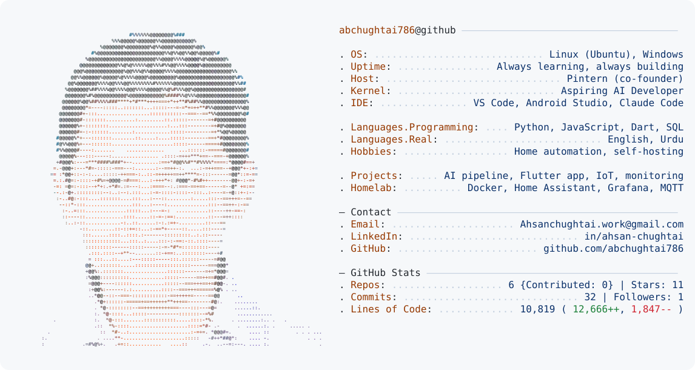

<a href="https://github.com/abchughtai786">
  <picture>
    <source media="(prefers-color-scheme: dark)" srcset="dark_mode.svg">
    
  </picture>
</a>

## ⭐ Featured projects

### [Automated Job Posting Pipeline](https://github.com/abchughtai786/automated-job-posting-pipeline)
A Node.js pipeline that collects job listings, screens out scams and bad posts with rules and AI, removes duplicates, and publishes SEO-friendly job pages.

`Node.js` `AI (Groq)` `WordPress API` `47 automated tests` `GitHub Actions`

### [Pintern: Flutter App Demo](https://github.com/abchughtai786/pintern-portfolio-demo) · [▶ Live demo](https://abchughtai786.github.io/pintern-portfolio-demo/)
A demo of Pintern, the student jobs and scholarships app I co-founded. It has four roles (student, employer, campus ambassador, admin), admin approval of posts, and permission checks in the data layer.

`Flutter` `Dart` `Firebase` `29 automated tests` `GitHub Pages`

### [Smart Water Management IoT](https://github.com/abchughtai786/smart-water-management-iot)
A real home system that monitors two water tanks with float sensors and runs the pumps automatically, with dry-run protection, power monitoring and phone alerts.

`Home Assistant` `MQTT` `ESP32 / ESP8266` `Sonoff` `Docker` `Linux`

### [Home Server Monitoring](https://github.com/abchughtai786/home-server-monitoring)
A one-command monitoring stack for a Linux home server: disk health warnings, resources and containers in one Grafana dashboard.

`Grafana` `InfluxDB` `Telegraf` `Docker Compose` `Linux`
